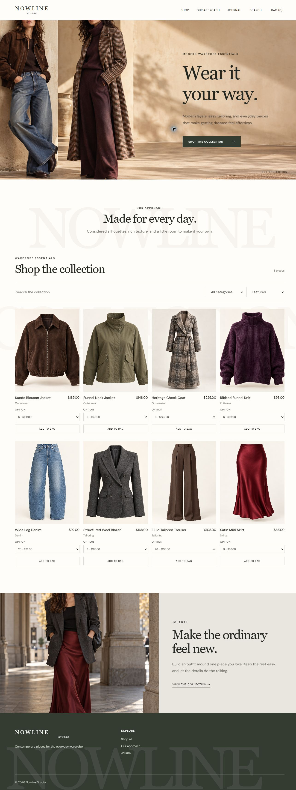

# Nowline Studio

Responsive fashion ecommerce storefront with editorial layouts, product search, category filters, sorting, size options, a persistent shopping bag, mobile navigation, and smooth section motion.

[View the live site](https://calina-miguel.github.io/nowline-studio-store/) | [View the full-site image](https://calina-miguel.github.io/nowline-studio-store/portfolio/nowline-full-site.jpg)



Built with HTML, CSS, and JavaScript. The storefront reads the local catalog in `catalog.json` until a Shopify Storefront API domain and public access token are configured in `config.js`. Live inventory, payments, and checkout require a connected Shopify merchant account.

## Scroll motion

`nowline-wheel.js` eases discrete mouse-wheel steps using elapsed time, so frame-rate changes do not change the feel of the scroll:

```js
const easing = 1 - Math.exp(-elapsed / 125);
position += (target - position) * easing;
scrollTo(0, position);
```

Touchpad scrolling, nested scroll areas, keyboard navigation, and reduced-motion preferences retain native behavior. `motion.js` updates the hero, introduction, collection, editorial section, and footer parallax layers in one animation frame per scroll update. The sticky header keeps a fixed height so scrolling does not shift page content.
